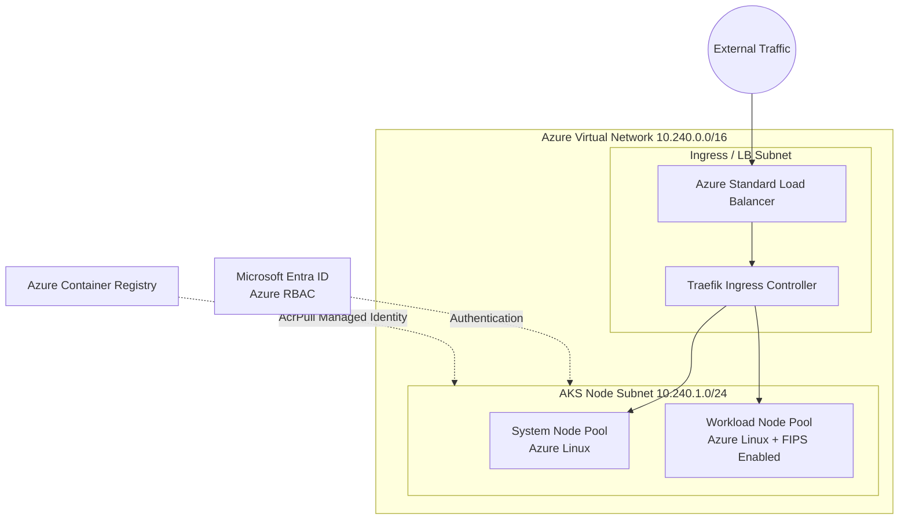

# AKS Enterprise Blueprint

[](https://github.com/papilias/aks-enterprise-blueprint/actions/workflows/terraform.yml)

Production-grade **Terraform** reference architecture for deploying a hardened **Azure Kubernetes Service (AKS)** cluster with **Microsoft Entra ID RBAC**, **FIPS-enabled Linux node pools**, private VNet subnetting, and **Traefik** ingress routing.

## Architecture Overview



## Repository Structure

```text
.
├── terraform/
│   ├── main.tf              # VNet, AKS cluster, FIPS user node pool & Entra ID RBAC
│   └── variables.tf         # Parameterized cluster sizing, Kubernetes version & region
├── kubernetes/
│   └── traefik-values.yaml  # Helm values for hardened Traefik ingress controller
└── .github/
    └── workflows/
        └── terraform.yml    # Automated terraform fmt & validate CI check
```

## Design Decisions
- **System vs. Workload Node Pool Separation:** Critical cluster add-ons (`coredns`, `metrics-server`) run on a dedicated tainted `system` pool, isolating application spikes from control-plane dependencies.
- **FIPS-140 & Azure Linux:** Workload node pools run on **Azure Linux** with FIPS mode enabled (`fips_enabled = true`) to satisfy enterprise and PCI/compliance cryptographic requirements out of the box.
- **Zero-Secret Registry Pull & Auth:** Cluster authentication uses **Microsoft Entra ID** with Azure RBAC (disabling local admin accounts), while image pulls from ACR rely strictly on Managed Identity (`AcrPull`) rather than static service principal secrets.
